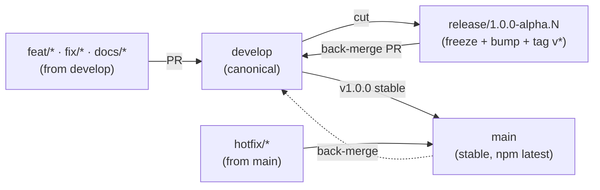

# Branch Workflow — Human Guide

> For 4 devs, `lumen-cli` `v1.0.0` train `alpha.1 -> alpha.2 -> beta.1 -> beta.2 -> stable` (ROADMAP.md M1-M5), parallel to `create-lumen` `v2.0.0`. Same flow `create-lumen` already uses (its PRs #56, #58, #59). See ADR 0002 and PLAN.md.

## TL;DR

- **`develop` is the canonical branch.** All work lands there (`feat/*`, `fix/*`, `docs/*`, `ci/*` → PR → `develop`).
- To ship a version, the release manager **freezes** it in `release/<version>` (cut from `develop`), bumps, tags `v<version>` there (CI publishes), and opens a **back-merge PR** `release/<version> -> develop`. Work on the next version continues in `develop`.
- **Never** push directly to `main` or `develop`. `main` only receives the stable `v1.0.0` (and `hotfix/*` after that).

## Graph



## Branches

| Branch | Purpose | Who owns it | Lifetime |
|--------|---------|-------------|----------|
| `develop` | Canonical development branch. Always green. Everything lands here. | Everyone, via PR | Permanent |
| `release/1.0.0-alpha.1` | Frozen snapshot of one version: bump `package.json` + `CHANGELOG.md`, sync docs, tag `v1.0.0-alpha.1`. Only critical fixes. | Release manager | Until the back-merge PR is merged |
| `feat/<scope>-<desc>` | Your feature (e.g. `feat/config-reader`, `feat/gen-core`). | You | Days, deleted after merge |
| `main` | What users see after `v1.0.0` (`npm@latest`). | Only stable / `hotfix/*` | Permanent |
| `hotfix/1.0.1` | Emergency on `main` after `v1.0.0`. Merged to `main`, then back to `develop`. | Fix author | Hours |

> `dev` and `release/v1.0.0` (cut from the initial commit) were retired; use `develop` and `release/<version>`.

## Naming

- `feat/<scope>-<description>`, `fix/<description>`, `docs/<description>`, `ci/<description>`
- `release/<version>` **without** `v`: `release/1.0.0-alpha.1`, `release/1.0.0-alpha.2`, `release/1.0.0-beta.1`, `release/1.0.0-beta.2`, `release/1.0.0-rc.1`, `release/1.0.0`
- Tags **with** `v`: `v1.0.0-alpha.1`
- `hotfix/<version>` e.g. `hotfix/1.0.1`

Prereleases always carry a number (`-alpha.1`, not `-alpha`): `publish.yml` maps `*-alpha.*` → `alpha`; a bare `-alpha` would fall through to `next`.

Commits: Conventional Commits — `feat:`, `fix:`, `chore(release):`, `docs:`, `ci:`, `test:`, `refactor:`.

## How to work (step by step)

### 1. Feature work (daily, 4 devs in parallel)

```bash
git checkout develop && git pull origin develop
git checkout -b feat/my-feature
# ... code ...
npm run lint && npm test
git commit -m "feat(scope): my feature (#n)"
git push -u origin feat/my-feature
# PR feat/my-feature -> develop, wait for review + green CI
```

> The default branch is `main`, so `Closes #n` does not auto-close issues when merging into `develop`. Close the issue and move its Project item to **Done** after the merge.

### 2. Freeze a version (release manager)

When `develop` meets a milestone DoD (ROADMAP.md):

```bash
git checkout develop && git pull
git checkout -b release/1.0.0-alpha.1
npm version 1.0.0-alpha.1 --no-git-tag-version
# CHANGELOG.md: [Unreleased] -> [1.0.0-alpha.1] — <date>; sync ROADMAP/README
git commit -am "chore(release): 1.0.0-alpha.1"
git push -u origin release/1.0.0-alpha.1
# Critical fixes only: fix/* -> PR -> release/1.0.0-alpha.1
git tag v1.0.0-alpha.1 && git push origin v1.0.0-alpha.1
# publish.yml: npm publish --tag alpha + GitHub prerelease
# Back-merge: PR release/1.0.0-alpha.1 -> develop
#   title: "chore: back-merge release/1.0.0-alpha.1 into develop"
```

Dist-tags: `alpha` → `npx lumen-cli@alpha`, `beta` → `@beta`, `rc` → `@rc`, `next` → generic, `latest` → stable.

### 3. Stable `v1.0.0` (M5)

```bash
git checkout -b release/1.0.0 develop
npm version 1.0.0 --no-git-tag-version
git commit -am "chore(release): 1.0.0"
# PR release/1.0.0 -> main, tag v1.0.0 (publish.yml: latest + GitHub Release)
# back-merge PR release/1.0.0 -> develop
```

### 4. Hotfix (only after `v1.0.0`)

```bash
git checkout main && git pull
git checkout -b hotfix/1.0.1
git commit -m "fix: ..."
# PR hotfix/1.0.1 -> main (tag v1.0.1), then back-merge main -> develop
```

## SemVer in 30 seconds

- `fix:` -> `1.0.1` (patch)
- `feat:` additive -> `1.1.0` (minor)
- Breaking CLI/config -> `2.0.0` (major)
- `lumen-cli` `v1.0.0` speaks `create-lumen` `v2` manifest only (ROADMAP.md).

## Coordination with create-lumen

| Milestone | create-lumen | lumen-cli | Status |
|-----------|--------------|-----------|--------|
| M1 Core | `v2.0.0-alpha.0` ✅ · `alpha.1` ✅ (manifest v2.1) | `v1.0.0-alpha.1` | Unblocked: `lumen-cli#3`/`#5` |
| M2 Generators | `v2.0.0-alpha.2` ✅ (engine, `none`/`hybrid`, shadcn) | `v1.0.0-alpha.2` | Unblocked: `lumen-cli#7`–`#14` (Next.js variants wait for create-lumen beta) |
| M3 UI registry | `create-lumen#33` ✅ | `v1.0.0-beta.1` | Unblocked: `lumen-cli#9` |
| M5 stable | `v2.0.0` | `v1.0.0` | Both `latest` |

## Checklists

**Before opening a PR to `develop`:**
- [ ] `git pull --rebase origin develop`
- [ ] `npm run lint` and `npm test` green

**Before cutting `release/*`:**
- [ ] `develop` green in CI
- [ ] Milestone DoD met (ROADMAP.md)

**Before tagging:**
- [ ] `package.json` and `CHANGELOG.md` bumped on the release branch
- [ ] No other `release/*` pending back-merge

## Do / Don't

- DO: small PRs, frequent rebases, delete `feat/*` after merge, back-merge every `release/*`.
- DON'T: develop features on `release/*`, `feat -> main`, direct push to `main`/`develop`, two active `release/*` at once.

## References

- ADR 0002: [`docs/adr/0002-branching-strategy.md`](./adr/0002-branching-strategy.md)
- Roadmap: [`ROADMAP.md`](../ROADMAP.md) · Plan: [`docs/PLAN.md`](./PLAN.md)
- CI: `.github/workflows/ci.yml`, `.github/workflows/eslint.yml`, `.github/workflows/publish.yml`
